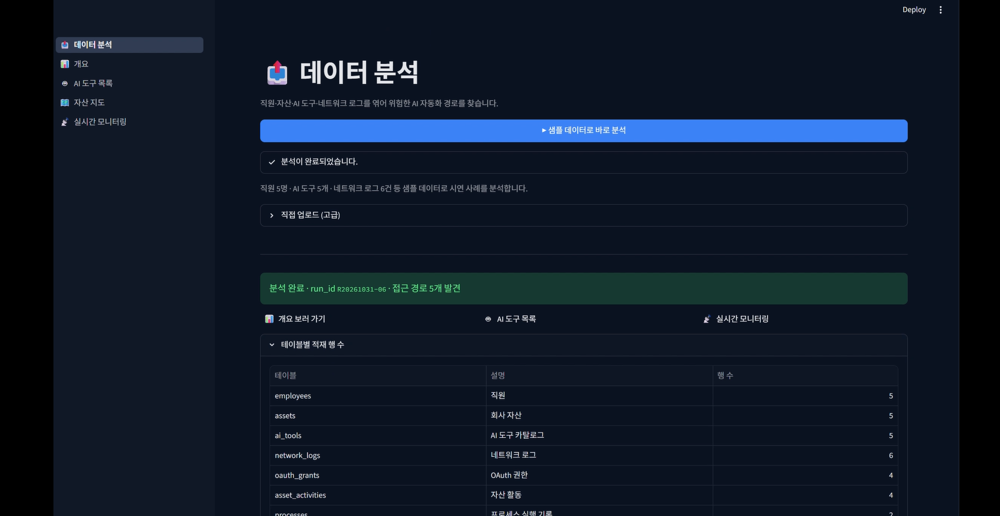
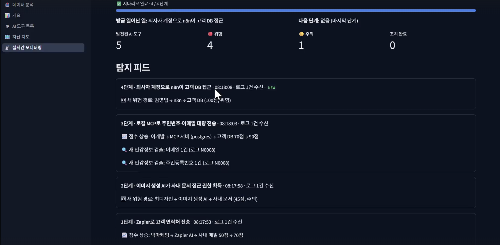
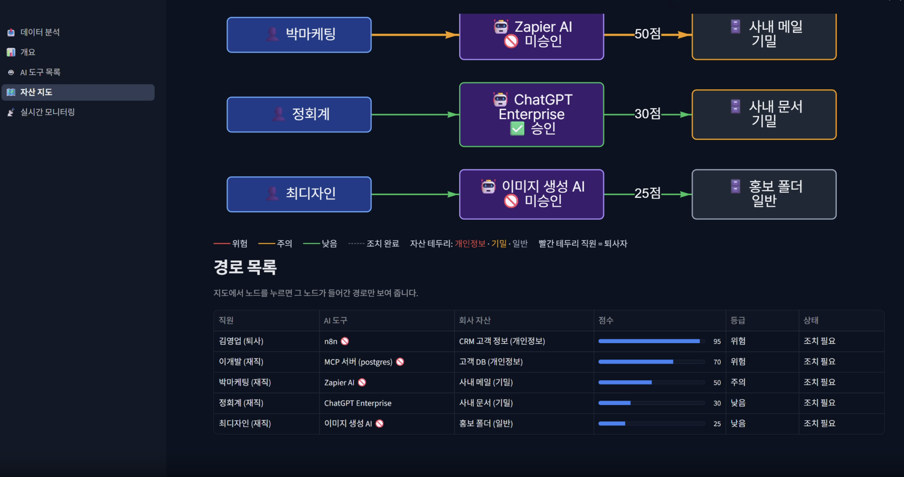

# Shadow Chaser

보안팀 없는 중소기업을 위한 AI 보안 모니터링 및 위험 분석 서비스

## 문제 정의

배경
직원들이 업무용 AI 도구를 직접 골라 회사 계정에 연결
OAuth·MCP로 메일, 드라이브, CRM, DB에 연결되어 데이터 읽기·수정·외부 전송까지 가능
'허용' 한 번이면 권한이 넘어가고, 관리자는 대부분 모름
퇴사자가 만든 자동화는 계정 정리 후에도 계속 동작

문제1: 불투명한 AI 사용
회사에서 어떤 AI 도구가 쓰이는지 목록이 없음
승인된 도구인지 아닌지 구분할 수 없음

문제2: 파편화된 기록들
접속 기록은 프록시 로그, 권한은 OAuth 기록, 사용 내역은 SaaS 감사 로그에 따로 남음
하나씩 봐서는 직원 → AI 도구 → 회사 자산 경로가 보이지 않음

문제3: 조치 기준이 없음
위험한 연결을 찾아도 무엇부터 막아야 할지 판단할 근거가 없음
결국 전부 차단해 업무가 멈추거나, 그냥 방치

기존 방법의 한계
기업용 보안 솔루션은 비싸고 운영 인력이 따로 필요
도메인 차단만으로는 다양한 AI 도구의 사용 현황과 실행 경로를 파악하기 어려움

목표
회사에 이미 쌓인 로그 파일만으로 AI 도구의 접근 경로 탐지
경로마다 근거와 위험도 점수를 보여 줘 조치 우선순위 판단 지원

## 해결 방법

해결 1: AI 도구 자동 탐지
프록시 로그, PC 프로세스 기록, OAuth 기록 등 파일 7개 업로드
접속 도메인과 프로세스 이름을 AI 카탈로그와 대조해 웹 AI·로컬 MCP 식별
회사 허용 목록과 비교해 미승인 도구 구분

해결 2: 로그 연결로 접근 경로 생성
OAuth 권한 기록과 SaaS 감사 로그를 직원·도구·자산 ID로 연결
직원 → AI 도구 → 회사 자산 경로 생성, 실제 권한 사용 여부 확인
자산 지도에서 직원·AI 도구·자산 관계를 그래프로 표시

해결 3: 근거 있는 위험도와 조치
비승인 여부, 권한 수준, 자산 민감도, 외부 전송, 퇴사자 여부 등 규칙별 점수 합산 (최대 100점)
위험 / 주의 / 낮음 3단계 등급
점수 항목마다 근거가 된 원본 로그 행 연결
AI로 전송된 내용에서 주민번호, API 키 등 민감 정보를 찾아 원문에 하이라이트
위험 경로 권한 회수 처리, 권한 축소·승인된 MCP 허브 이전 등 업무를 멈추지 않는 조치 추천

## 주요 기능

로그 업로드 및 검증
로그·목록 파일 7개(CSV 6개, JSON 1개) 업로드
파일 형식과 필수 열 검사 후 DB 저장, 오류가 있으면 문제 열 안내

AI 도구 탐지
프록시 로그의 접속 도메인, PC 프로세스 이름을 AI 카탈로그와 대조
AI 도구·로컬 MCP 식별 및 회사 승인 여부 판별

전송 내용 스캔
AI로 전송된 데이터에서 주민번호, 전화번호, 이메일, API 키, 소스코드 패턴 검출 (정규식)
검출된 부분을 원문 위에 하이라이트

접근 경로 분석
OAuth 권한 기록과 SaaS 감사 로그를 직원·도구·자산 ID로 연결
직원 → AI 도구 → MCP → 회사 자산 경로 생성, 실제 권한 사용 여부 확인

위험도 점수 (Exposure Score)
비승인 도구, 쓰기·삭제 권한, 개인정보 자산 접근, 외부 전송, 퇴사자 소유 등 9개 규칙으로 점수 산정
위험 / 주의 / 낮음 3단계 등급, 항목별 근거 로그 연결

대시보드
AI 도구 수, 등급별 건수, 위험도 순위
직원·AI 도구·자산 관계를 노드 그래프로 표시

## 기술 스택

| 분야 | 사용 기술 |

|------|-----------|

| 백엔드 | Python, FastAPI, Uvicorn, pandas, SQLite, pytest |

| 프론트엔드 | Streamlit |

## 시스템 구조

!architecture.png

## 실행 방법

### Docker로 실행

```bash
docker compose up --build
```

백엔드:

```bash
cd 26_R
.\.venv\Scripts\Activate.ps1
cd backend
uvicorn app.main:app --reload --port 8000
```

- 실행되면 브라우저에서 확인.
    - API 문서: http://localhost:8000/docs (업로드와 분석을 직접 눌러 볼 수 있음)
    - 상태 확인: http://localhost:8000/api/health → `{"status": "ok"}`가 나오면 정상

프론트엔드:

```bash
cd 26_R
.\.venv\Scripts\Activate.ps1
cd frontend
streamlit run app.py
```

- http://localhost:8501 로 접속.

## 시연




실시간 로그 목록 파일  분석



분석한 데이터 실시간 모니터링으로 위험 점수 산출 및 위험도 판단



직원·AI 도구·회사 자산의 연결과 경로별 위험 점수를 보여 주는 자산 지도 화면

## 팀원

| 이름 | 역할 |

정혜원 | 팀장, 백엔드, 프론트엔드

김세령 | 프론트엔드

김동은 | 백엔드

박석원 | 백엔드

변관영 | PPT

지원근 | 프론트엔드

주수환 | 백엔드

### 브랜치

- main: 항상 실행 가능한 코드만 유지 (직접 push 금지, PR로만 머지)
- 작업은 기능별 브랜치에서 진행

| 접두어 | 용도 | 예시 |

|---|---|---|

| feat/ | 새 기능 | feat/login |

| fix/ | 버그 수정 | fix/sensor-read |

| docs/ | 문서 수정 | docs/readme |

| refactor/ | 코드 정리 | refactor/api |

### 커밋 메시지

타입: 작업 내용 형식으로 작성

| 타입 | 의미 |

|---|---|

| feat | 새 기능 추가 |

| fix | 버그 수정 |

| docs | 문서 수정 |

| style | 코드 포맷, 들여쓰기 등 (동작 변화 없음) |

| refactor | 코드 구조 개선 |

| chore | 설정, 패키지 등 기타 작업 |

feat: 로그인 페이지 추가

fix: 온도 센서 값 오류 수정

- 한 커밋에는 한 가지 작업만
- "수정", "final" 같은 의미 없는 메시지 금지

### Pull Request

- 작게, 자주 올리기
- 제목은 커밋 메시지와 같은 형식
- 본문에 **무엇을 / 왜 / 어떻게 확인했는지** 작성
- 머지는 **Squash and merge** 사용
- 머지 후 브랜치 삭제

### 작업 순서

git checkout develop

git pull                          # 작업 전 반드시 최신화

git checkout -b feat/기능이름

git add .

git commit -m "feat: 기능 설명"

git push -u origin feat/기능이름

\# GitHub에서 PR 생성 → 리뷰 → 머지
\# 협업 규칙
브랜치, 커밋, PR 규칙은 PR_RULES.md를 참고하세요.

### 주의 사항

- 작업 시작 전 git pull 필수
- 같은 파일을 동시에 수정하지 않기 (담당 파일 미리 분배)
- 마감 1~2시간 전부터 main 머지 동결
- .env, API 키 등 비밀 정보는 절대 커밋 금지